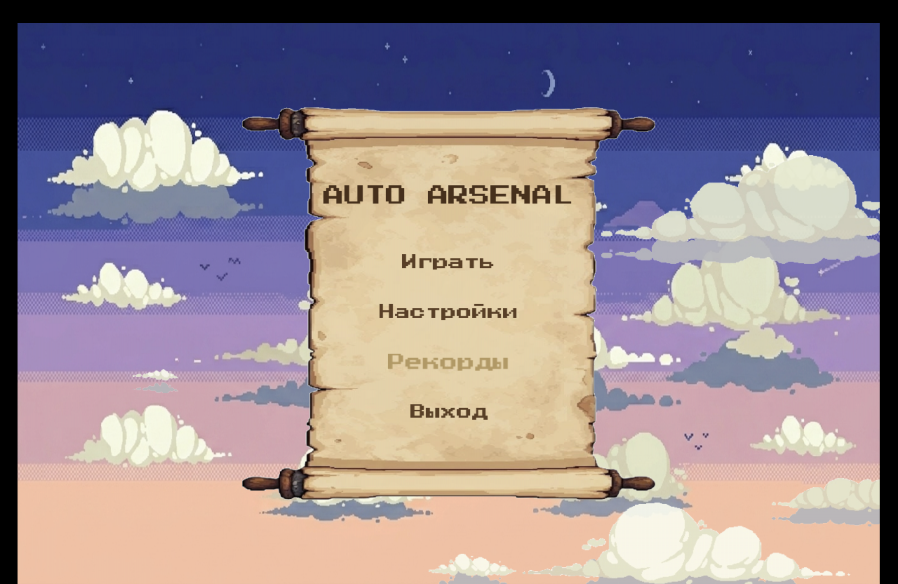
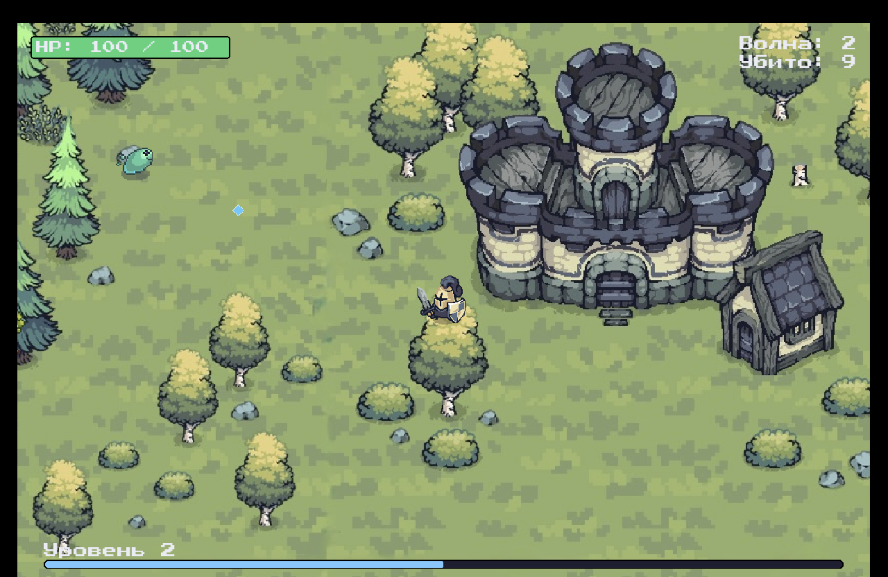
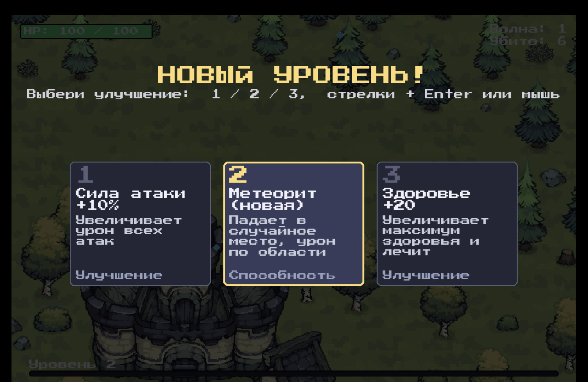

# 🎮 Auto Arsenal

<div align="center">


**Roguelike-выживач с автоатакой против нарастающих волн врагов**

*Двигайся, уклоняйся, качайся — оружие стреляет само!*

[Особенности](#-особенности) • [Установка](#-установка) • [Управление](#-управление) • [Документация](#-документация)

</div>

---

## 📖 Описание

**Auto Arsenal** — это roguelike в жанре survivor/bullet-heaven, вдохновлённый **Vampire Survivors** и **Brotato**. Игрок управляет персонажем на арене, где оружие атакует врагов автоматически. Задача — выживать против всё более плотных волн противников, прокачивать способности и продержаться как можно дольше.

### 🎯 Ключевая механика

- **Автоатака** — оружие само находит и атакует ближайших врагов
- **Волны врагов** — каждые 6 секунд новая волна, всё сильнее и плотнее
- **Прокачка** — система опыта и level-up с выбором усилений
- **5 активных способностей** — от огненных пуль до падающих метеоритов
- **6 типов врагов** — 3 тира слаймов и 3 тира орков с уникальными характеристиками

---

## ✨ Особенности

🎯 **Простое управление** — только движение, никаких кнопок атаки  
⚔️ **Автоматический бой** — снаряды летят в ближайших врагов  
📈 **Прогрессия** — система опыта, уровней и выбора усилений  
🌊 **Волновая система** — новые типы врагов разблокируются на волнах 4 и 8  
🎨 **Пиксель-арт** — анимированные спрайты персонажей (idle/run/attack/hurt/death)  
💎 **Дроп-система** — опыт и аптечки с магнитным подбором  
🔥 **Активные способности** — огненная аура, молния, фаербол, метеорит  

---

## 🎬 Скриншоты

<div align="center">

<table>
  <tr>
    <td align="center">
      <br>
      <sub><b>Главное меню</b><br>Анимированные облака и пергаментная панель</sub>
    </td>
    <td align="center">
      <br>
      <sub><b>Геймплей</b><br>Автоатака по врагам, дропы и полоски HP</sub>
    </td>
  </tr>
  <tr>
    <td align="center" colspan="2">
      <br>
      <sub><b>Выбор усиления</b><br>3 случайных улучшения при Level Up</sub>
    </td>
  </tr>
</table>

</div>

---

## 🚀 Установка

### Требования

- Python 3.11 или выше
- pip (менеджер пакетов Python)

### Шаги установки

```bash
# 1. Клонируй репозиторий
git clone https://github.com/ваш-username/Python-Game.git
cd Python-Game

# 2. Создай виртуальное окружение
python -m venv venv

# 3. Активируй окружение
# macOS/Linux:
source venv/bin/activate
# Windows:
venv\Scripts\activate

# 4. Установи зависимости
pip install -r requirements.txt

# 5. Запусти игру!
python main.py
```

---

## 🎮 Управление

| Действие | Клавиши |
|----------|---------|
| 🏃 **Движение** | `W A S D` или `↑ ← ↓ →` |
| ⚔️ **Атака** | Автоматическая (по ближайшему врагу) |
| 🆙 **Выбор усиления** | `1` `2` `3` или `← →` + `Enter` или `ЛКМ` |
| ⏸️ **Пауза** | `Esc` |
| 🔄 **Рестарт** | `R` (после Game Over) |
| 🏠 **В меню** | `Q` (из паузы) |

---

## 🎯 Геймплей

### Волны врагов

| Волна | Враги | Особенности |
|-------|-------|-------------|
| **1-3** | 🟢 Slime 1, Orc 1 | Базовые типы, медленные |
| **4-7** | 🟡 Slime 2, Orc 2 | Средний тир, быстрее и сильнее |
| **8+** | 🔴 Slime 3, Orc 3 | Сильный тир, высокий HP и урон |

*Враги становятся сильнее с каждой волной: +6% HP, +4% урон*

### Система прокачки

**3 пассивных усиления:**
- 💪 **Сила атаки +10%** — увеличивает урон всех атак
- ⚡ **Скорость атаки +7%** — атаки происходят чаще
- ❤️ **Здоровье +20** — увеличивает макс. HP и лечит

**5 активных способностей (до 8 уровня):**
- 🔥 **Огненная пуля** — снаряд в ближайшего врага
- 🌀 **Огненная аура** — урон по кругу вокруг игрока
- ⚡ **Атака молнией** — мгновенный удар по цели
- 💥 **Фаербол** — взрыв по области при попадании
- ☄️ **Метеорит** — падает в случайную точку, мощный AOE

### Дропы

- 💎 **Кристаллы опыта** — выпадают всегда, дают XP
- 🏥 **Аптечки** — 8% шанс, восстанавливают 25 HP
- 🧲 **Магнитный подбор** — дропы притягиваются на расстоянии 160 px

---

## 📊 Структура проекта

```
Python-Game/
├── 📄 main.py                    # Точка входа, игровой цикл
├── 📄 records.json               # Сохранённые рекорды
├── 📁 src/                       # Исходный код
│   ├── settings.py               # Все настройки игры
│   ├── player.py                 # Персонаж игрока
│   ├── enemy.py                  # Враги с типами
│   ├── abilities.py              # Активные способности
│   ├── pickups.py                # Дропы с магнитом
│   ├── wave_manager.py           # Управление волнами
│   ├── menu.py                   # Меню и UI
│   └── ...                       # Другие модули
├── 📁 assets/                    # Графические ассеты
│   ├── player/                   # Спрайты игрока
│   ├── enemy/                    # Спрайты врагов (6 типов)
│   ├── effects/                  # Эффекты способностей
│   ├── tiles/                    # Тайлы карты
│   └── menu/                     # Ассеты меню
├── 📁 docs/                      # Документация
│   ├── GDD.md                    # Game Design Document
│   ├── Концепт-документ.md       # Концепция проекта
│   ├── ui_main_menu.jpg          # Скриншот меню
│   └── ui_gameplay.jpg           # Скриншот геймплея
└── 📄 requirements.txt           # Зависимости Python
```

---

## 📚 Документация

- 📘 [**Концепт-документ**](./docs/Концепт-документ.md) — концепция игры, УТП, референсы
- 📗 [**Game Design Document (GDD)**](./docs/GDD.md) — полное описание механик, врагов, UI/UX

---

## 🎨 Технологии

<div align="center">


</div>

- **Python 3.11+** — основной язык
- **Pygame** — фреймворк для 2D игр
- **Спрайт-анимации** — система покадровой анимации
- **FSM** — машина состояний для игровых экранов


---

## 🎯 Особенности реализации

### Система врагов
- **6 типов** с уникальными характеристиками
- **4 анимации** на каждого: run, attack, hurt, death
- **Динамическое масштабирование** HP и урона от номера волны
- **Система весов** для спавна (новые типы постепенно вытесняют старых)

### Боевая система
- **Автонаведение** на ближайшего врага в радиусе 500 px
- **Снаряды** с физикой полёта и радиусом попадания
- **5 типов способностей** с независимыми кулдаунами
- **Визуальные эффекты** для каждой атаки

### Прогрессия
- **Формула опыта:** `5 × (1.35^(N-1)) + 3×(N-1)`
- **Выбор из 3 усилений** при каждом level-up
- **Прокачка способностей** до 8 уровня
- **Сохранение рекордов** в JSON

---

## 👥 Команда

<table>
  <tr>
    <td align="center">
      <b>Корлович Илья</b><br>
      <sub>Разработчик</sub>
    </td>
    <td align="center">
      <b>Безмен Максим</b><br>
      <sub>Разработчик</sub>
    </td>
  </tr>
</table>

**Руководитель проекта:** Казанцева Ольга Геннадьевна

---

## 🗓️ Статус разработки

| Версия | Дата | Статус | Описание |
|--------|------|--------|----------|
| **0.2** | 2026-07-09 | 🟢 Прототип готов | Все основные механики реализованы |
| **0.1** | 2026-07-02 | 🟡 Проектирование | Концепция и дизайн-документы |

### ✅ Реализовано

- [x] Система движения и камеры
- [x] Автоатака по врагам
- [x] 6 типов врагов с анимациями
- [x] Система волн с прогрессией
- [x] Опыт, уровни, выбор усилений
- [x] 5 активных способностей
- [x] 3 пассивных усиления
- [x] Дропы с магнитным подбором
- [x] Главное меню с анимацией
- [x] HUD с полосами HP/XP
- [x] Экраны паузы и Game Over
- [x] Сохранение рекордов

### 🚧 В планах

- [ ] Звуковые эффекты и музыка
- [ ] Спрайты для эффектов способностей (сейчас процедурный рендер)
- [ ] Дополнительные типы врагов
- [ ] Босс-файты на финальных волнах
- [ ] Система достижений
- [ ] Настройки звука и графики

---

## 🎮 Жанр и референсы

**Жанр:** Roguelike / Survivor / Bullet-Heaven

**Вдохновлено:**
- 🧛 [Vampire Survivors](https://store.steampowered.com/app/1794680/Vampire_Survivors/) — автоатака, система волн
- 🥔 [Brotato](https://store.steampowered.com/app/1942280/Brotato/) — выбор усилений, баланс оружия
- 🏰 [Halls of Torment](https://store.steampowered.com/app/2218750/Halls_of_Torment/) — пиксель-арт атмосфера

---

## 📝 Лицензия

Этот проект создан в образовательных целях.

---

## 🤝 Вклад в проект

Проект разработан студентами в рамках учебного курса. Если у вас есть идеи или предложения — создайте Issue!

---

<div align="center">

**Сделано с ❤️ и Python**

⭐ Поставьте звезду, если вам понравился проект!

</div>
